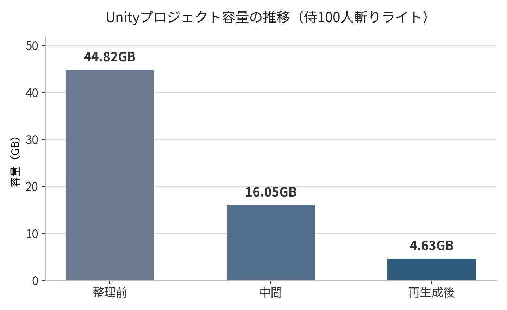

iOSで一番人気の「侍100人斬りライト」。長年の開発でUnityプロジェクトが **44.82GB** まで膨らんでいたので、大規模な整理を行いました。

結論から書くと、**約4.63GB（約10分の1）** になりました。そして一番の発見は、容量の主犯はアセットではなく **Gitの履歴** だったことです。

*プロジェクト容量の推移。44.82GB → 16.05GB → 約4.63GBと、段階を踏んで落とした*

## まず内訳を測る

思い込みで消し始めないために、最初にフォルダごとの容量を実測しました。

| 区分 | 容量 | 中身 |
|---|---|---|
| Gitの履歴（.git） | 26.81GB | うち約23GBは Git LFS で管理していた大容量ファイルの実体 |
| Assets | 10.74GB | ゲームのアセット本体 |
| Library | 6.62GB | Unityが自動生成するキャッシュ |
| その他 | 約0.65GB | 設定ファイルなど |

合計44.82GBのうち、**6割近くがGitの履歴** でした。「アセットが太ったのだろう」と思っていたので、これは意外でした。過去に何度も差し替えた大容量バイナリが、履歴の中に世代ごと残り続けていたのが原因です。

### なぜ履歴がここまで太るのか

テキストのソースコードなら、Gitは差分だけを記録するので履歴はあまり太りません。ところが画像や音声のようなバイナリファイルは差分が効かず、差し替えるたびにファイル全体が新しい世代として履歴に残ります。Git LFS を使っていても、実体の置き場所が変わるだけで、世代ごとの実体が残ることに変わりはありません。数百MBの素材を何十回も差し替えれば、それだけで履歴はGB単位に育ちます。「今のプロジェクトは軽いのに、フォルダ全体は重い」という状態は、この仕組みで起きていました。

## 残すもの・退避するものの基準

消す判断で迷わないように、基準を先に決めました。

- **残す**: 今のビルドに含まれる物と、そこから参照・関連のある物だけ
- **退避する**: それ以外は削除せず、プロジェクトの外の退避フォルダへ移して管理外にする（原本は保持）
- **作り直す**: Gitの履歴は最初から作り直す。大容量バイナリは履歴に載せない運用に変え、.meta ファイルは全て管理する

「いきなり消す」のではなく「まず退避する」にしたのがポイントです。原本が残っているので、思い切った除外ができます。

### 判断に迷ったもの

一番迷ったのは、Assets の中にある「今は使っていないかもしれない」アセットです。ファイル名だけでは判断できないので、シーンやプレハブから参照を辿り、どこからも辿れないものを退避候補にしました。逆に、容量が大きくても現行のビルドで参照されているものは残しています。「大きいから消す」ではなく「参照されているかどうか」で決めるのが、この整理の物差しです。

もう1つ迷ったのが、過去のバージョンの素材や、実験用に作ったシーンです。思い入れはあっても、今のビルドと関係がなければ退避に回しました。退避フォルダに原本が残るので、必要になればいつでも戻せます。

## やったこと

1. フォルダごとの容量を測り、内訳を確定する
2. ビルドに含まれる物と参照関係を洗い出し、残す範囲を決める
3. 範囲外の物を退避フォルダへ移し、管理外にする
4. Gitの履歴を最初から作り直す（大容量バイナリは管理外、.meta は全て管理）
5. Libraryは捨てて、Unityに再生成させる
6. 全シーンの切り替えと実戦闘で動作を検証する

## 結果

| 段階 | 容量 |
|---|---|
| 整理前 | 44.82GB |
| 退避・除外のあと | 16.05GB |
| 再生成のあと | 約4.63GB |

**約10分の1** になりました。

軽量化で一番怖いのは「消しすぎて壊れること」なので、検証は丁寧にやりました。全10シーンの切り替えを確認し、自動プレイで実際の戦闘まで通して、Consoleエラーが0件であることを確認しています。参照切れがあれば、この段階でエラーや表示の異常として出てくるはずです。プロジェクトが軽くなった分、コピーやバックアップにかかる負担も目に見えて減りました。

## この整理でやらなかったこと

範囲を明確にするために書いておくと、アセット自体の圧縮（テクスチャの解像度や音声の形式の見直し）や、シーン・プレハブ構成の作り替えは、今回の対象外です。内訳を測った時点で容量の主犯がGitの履歴だと分かったので、まずは保管と履歴の整理に集中しました。アセット側の最適化は、必要になった時点で別途取り組みます。問題の場所を特定してから、そこだけを直す。その順番が結果的に一番速かったです。

## 学び

- **主犯はアセットではなく履歴だった**: 容量の問題は、まず内訳を実測してから手を付けるべきでした。思い込みでアセット整理から始めていたら、遠回りしていたと思います
- **消す前に退避する**: 原本を残したまま攻めることで、大胆な除外ができるようになります。「消す勇気」は、戻せる仕組みから生まれます
- **.meta は全て管理する**: Unityの参照は .meta の GUID でつながっています。ここを管理外にすると参照切れの事故のもとになるので、容量が小さくても全て管理対象にしました
- **Library は抱え込まない**: 自動生成されるキャッシュは、捨てれば再生成できます。バックアップや履歴に残す価値はありません

## これから

整理して終わりではなく、太らない運用に変えるのが本番です。これからは次のルールで回します。

- 大容量バイナリはGitの履歴に載せず、履歴の外で版を管理する
- フォルダごとの容量を定期的に測り、内訳の変化を見る（増えたら理由を確認する）
- 退避フォルダの中身も定期的に見直し、本当に不要になったものから処分する

一度太ったプロジェクトの整理は、内訳の実測から始めれば怖くありません。同じように「なんとなく重い」プロジェクトを抱えている方の参考になればうれしいです。

---

※ この記事は [wabiplantメディア](https://portfolio.wabiplant.workers.dev/media/samurai100-project-slimming/) に掲載した記事の転載です。
